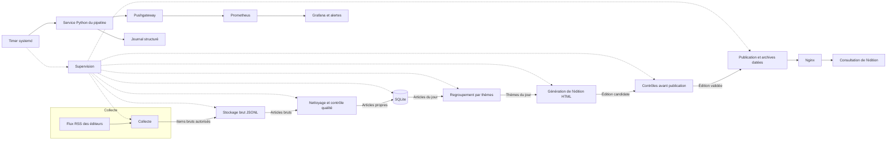

# Architecture cible — La gazette

Statut : schéma de principe à relire collectivement.
Les choix principaux sont validés ; les détails de déploiement,
les droits de réutilisation, le fuseau de publication et les paramètres
de supervision restent à préciser.

## 1. Vue d'ensemble

La gazette est un pipeline quotidien qui collecte les métadonnées
autorisées depuis les flux RSS des éditeurs, les nettoie et les
déduplique, les regroupe par thèmes, puis génère une édition HTML
statique servie par Nginx.

Les traitements sont exécutés par des conteneurs Python, déclenchés
chaque matin par systemd. Les données brutes sont conservées en JSONL ;
les données propres, les thèmes et les éditions sont enregistrés
dans SQLite. Prometheus, Pushgateway et Grafana assurent la supervision.

## 2. Schéma

## 3. Composants et responsabilités

| Composant | Rôle | Entrées | Sorties |
|---|---|---|---|
| Timer systemd | Déclencher le service Python avant 7 h, avec marge de sécurité | Configuration versionnée | Lancement du pipeline |
| Service Python | Ordonner les étapes, exécuter les contrôles et émettre les métriques | Configuration, données persistantes | Résultats, journaux et métriques |
| Collecte RSS | Récupérer les titres, extraits, liens et dates autorisés | Flux RSS des éditeurs | Items bruts en JSONL |
| Stockage brut | Conserver les métadonnées autorisées et leur provenance | Items bruts | Fichiers JSONL datés |
| Nettoyage et qualité | Normaliser les champs, contrôler les dates, éliminer les doublons | Articles bruts | Articles propres |
| SQLite | Conserver les articles propres, thèmes et éditions | Articles propres, résultats | Données interrogeables |
| Regroupement | Former des groupes à partir de TF-IDF et de la classification hiérarchique | Titres et extraits propres | Thèmes, termes caractéristiques, paramètres |
| Génération HTML | Créer l'édition candidate à partir des thèmes et des articles | Thèmes, articles, configuration | Fichiers HTML et manifeste |
| Contrôles | Vérifier la fraîcheur, les champs, les liens et les droits de diffusion | Édition candidate, données de référence | Édition validée ou rejetée |
| Publication | Rendre l'édition accessible et conserver les archives datées | Édition validée | Répertoire de publication et archives |
| Nginx | Servir les fichiers HTML en lecture seule | Répertoire de publication | Édition accessible |
| Supervision | Collecter les métriques, afficher les tableaux de bord et déclencher les alertes | Pushgateway, journaux, contrôles | Métriques, tableaux de bord, alertes |

## 4. Données échangées

| Étape | Donnée échangée | Format ou support |
|---|---|---|
| Éditeurs vers collecte | Titres, extraits, liens, dates et métadonnées autorisées | Flux RSS |
| Collecte vers stockage brut | Items bruts avec source, URL, date de collecte et provenance | JSONL |
| Stockage brut vers nettoyage | Articles bruts | JSONL |
| Nettoyage vers SQLite | Articles propres, identifiants, dates normalisées et empreintes de déduplication | SQLite |
| SQLite vers regroupement | Articles du jour, titres et extraits autorisés | Requêtes SQLite |
| Regroupement vers génération | Thèmes, membres, termes caractéristiques et paramètres | SQLite et fichiers de résultats |
| Génération vers contrôle | Édition candidate, manifeste et liste des contrôles | HTML, JSON et fichiers de contrôle |
| Contrôle vers publication | Édition validée et métadonnées de publication | Fichiers HTML et manifeste |
| Publication vers Nginx | Édition courante et archives datées | Répertoire persistant en lecture seule |
| Pipeline vers supervision | Compteurs, statuts, durées, dates et erreurs | Pushgateway |
| Services vers supervision | Métriques et journaux | Prometheus et journal structuré |

## 5. Lieux d'exécution

| Élément | Lieu d'exécution | Persistance |
|---|---|---|
| Timer et service systemd | Hôte Linux de production | Configuration versionnée |
| Pipeline Python | Conteneur Docker | Volumes persistants |
| JSONL | Volume Docker ou répertoire hôte | Persistant, hors Git |
| SQLite | Volume Docker ou répertoire hôte | Persistant, hors Git |
| Éditions HTML et archives | Volume de publication | Persistant, hors Git |
| Nginx | Conteneur Docker | Accès en lecture seule au répertoire de publication |
| Prometheus | Conteneur Docker | Volume persistant |
| Pushgateway | Conteneur Docker | Volume persistant |
| Grafana | Conteneur Docker | Volume persistant |
| CI et construction d'image | GitHub Actions | Artefacts et image versionnée |
| Déploiement | Ansible depuis une machine de l'équipe vers le serveur | Configuration versionnée |

## 6. Sécurité et périmètre de publication

Les secrets ne seront pas stockés dans Git. Ils seront fournis
par un mécanisme à définir, avec des permissions limitées.

Nginx ne servira que le répertoire de publication. Les fichiers JSONL,
la base SQLite, les journaux internes, les configurations sensibles
et les secrets ne seront pas exposés.

L'adresse de consultation, HTTPS, les éventuelles restrictions d'accès
et la durée de conservation des archives restent à définir selon
l'infrastructure et les droits de réutilisation.

## 7. Points à préciser

- Fuseau de référence de l'édition et règle exacte de fraîcheur.
- Droits de réutilisation, de diffusion et d'archivage des sources.
- Version de Python, dépendances, organisation des modules et commandes.
- Workflows GitHub Actions, registre ou transfert d'images et quotas.
- Accès au serveur, privilèges, sauvegardes, restauration et retour arrière.
- Seuils, rétentions, canal de notification et procédures de relance.
- Détails de l'évaluation du regroupement et de l'échantillon annoté.